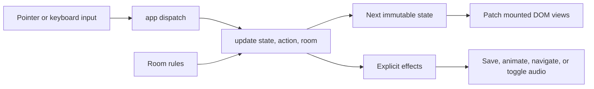

# Application architecture

Savagely Optimized is a static TypeScript application built with Vite. A pure reducer owns adventure state; small DOM views and browser adapters carry out its results. There is no runtime state-management dependency or backend.

## Data flow

`src/main.ts` imports fonts and styles and starts the app. `src/app.ts` is the composition root: it selects the room, loads progress, mounts views, and connects dispatch to the reducer and effects. State is local to that application instance. There is no exported mutable singleton, event bus, or subscription framework.

## Game rules

- `src/game/model.ts` defines readonly state, typed actions and effects, and the room contract.
- `src/game/update.ts` handles movement, verbs, inventory selection, contextual action sentences, and restart. Room-specific actions and prop interactions are delegated to the supplied room.
- `src/game/rooms/mcgill.ts` owns the lab artwork metadata, hotspot geometry, destinations, dialogue, paper link, ticket, Recommendz rules, and save codec.

The shared reducer is parameterized by a room's state and actions. McGill uses that extension for the computer's open state and recommendation result. Future rooms can have different puzzles without adding their cases to the shared reducer. Unit tests exercise a separate workshop fixture to check this boundary.

Browser input produces an action, for example `dispatch({ type: 'interact', prop: 'papers' })`. The application evaluates `update(state, action, mcgill)`, receiving `{ state, effects }`.

The reducer never reads storage, accesses the DOM, changes location, starts a timer, or creates audio. Its result depends only on its inputs. Movement includes the destination and duration as an effect; the view animates the existing character node. Persistence is coalesced to one write per dispatch.

The build checks `src/game` separately with the ES2022 library and no DOM or Node ambient types. Accidentally introducing browser APIs into game rules fails typechecking.

## Progress and temporary state

Only `Progress` is persisted: inventory, chapter completion, and character position. Selected verbs/items, hovered props, dialogue, and computer state are temporary and reset on reload. The room's initial-state factory gives restart and separate app instances fresh state.

The McGill save adapter retains the existing `savagely-optimized:mcgill:v1` key and `{ ticket, completed, x, y }` payload. Its codec translates that wire format into the internal model. Existing visitors need no migration. Decoding validates booleans, bounds coordinates, and prevents completion without the ticket. A new save format should use an explicit version and compatibility strategy.

`src/browser/saves.ts` catches malformed JSON, denied storage access, and quota errors. Loading falls back to fresh progress; saving reports failure so the shell can announce it. It never clears unrelated browser storage.

## Views and browser services

- `src/ui/adventure.ts` mounts the generic room, translates input into actions, patches controls and dialogue, and animates movement.
- `src/ui/recommendz.ts` owns the McGill computer's markup, checkbox input, native dialog, and focus handling. The reducer validates the puzzle and authorizes ticket awards. Checkbox selection stays local to the form until submitted.
- `src/ui/pages.ts` renders the career overview and chapter map from `src/content/career.ts`.
- `src/ui/shell.ts` renders the site shell and handles sound indicators, toasts, and save announcements. Puzzle markup is supplied by the composition root.
- `src/browser/navigation.ts` handles hash routes, titles, active links, scrolling, and navigation focus.
- `src/browser/audio.ts` lazily creates and owns the Web Audio graph, serializes toggles, suspends hidden-tab audio, and releases resources on disposal.

Views mount once and update existing nodes. Hovering does not replace the room or form and does not rewrite unchanged live-region text. Native dialog cancellation dispatches the close action before focus restoration, keeping reducer state and the browser synchronized. Keyboard commands are scoped to the active game and are inactive while the computer is open.

Each mounted view/service exposes disposal for its listeners, timers, or audio resources. The entry point registers app disposal with Vite hot-module replacement. The existing stylesheet and artwork are retained. Hotspot percentages now live in the room definition and are rendered as inline geometry, avoiding separate coordinates in TypeScript and CSS.

## Adding the next chapter

1. Add a room module with its own state/actions, props, inventory items, initial state, and pure puzzle rules.
2. Provide a save codec and a distinct save key for that room.
3. Reuse the adventure view and supply a puzzle view if needed. Register the room and its view/codec in the composition root when enabling navigation to it.
4. Add rule tests and a complete browser journey for the new puzzle. Update the career chapter's playable status only once the room exists.

There is currently one playable room, so selection is explicit in `app.ts`. A room registry, multi-room routing, cross-chapter inventory, and asset loading should be introduced when the second playable room establishes their requirements.

## Validation and delivery

`npm run test:unit` runs Vitest under Node. Tests cover deterministic and immutable transitions, movement bounds, inventory, puzzle validation and completion, save compatibility and failures, and the audio lifecycle. Small fakes stand in for browser storage and audio; reducer tests need no DOM environment.

`npm run test:e2e` runs Playwright at desktop and mobile sizes. It exercises the full puzzle, navigation, focus, input scoping, persistence including legacy saves, sound failure, links, artwork, layout overflow, and stable verb positions. The external PDF destination is intercepted in its navigation test; that checks the outgoing link, not remote PDF availability. Screenshots are generated for inspection, not stored as snapshot assertions.

`npm test` runs both suites. `npm run build` typechecks application code, tests, and configuration, checks the isolated game modules, and emits `dist/`.

`.github/workflows/check.yml` runs unit tests, the production build, and browser tests against `dist/` on pull requests and pushes to `main`. Cloudflare continues to build `npm run build` and publish `dist/`; no runtime services or deployment-setting changes are required. The workflow provides checks; deployment gating depends on repository and Cloudflare settings.
