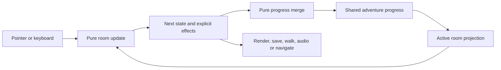

# Application architecture

Savagely Optimized is a static TypeScript application built with Vite. Pure reducers and progress functions own the game rules; mounted DOM views and browser adapters carry out effects. There is no runtime state-management dependency or backend.

## One adventure, mounted room views

`src/app.ts` owns one `AdventureProgress` value for the application lifetime. It loads the whole-adventure save, remembers the active room and mounts one typed room session at a time. Reading routes retain that room session. Room switching disposes its listeners and timers, then mounts the next room from shared progress.

`src/game/adventure.ts` defines the shared item catalogue, playable room definitions and readonly persistent model: inventory, milestones, completion, current room and positions keyed by room. `roomProgress` projects the shared inventory/flags and the active position into a room reducer. `applyRoomProgress` merges its immutable result without replacing other rooms' positions. `enterRoom` records navigation. None accesses the DOM or browser storage.

`src/chapters.ts` is the typed composition registry. It supplies all rooms with the same inventory catalogue, so an item remains visible, named and selectable outside its source room. `src/chapter.ts` owns transient typed room state and executes effects. It receives progress from the adventure owner, reports changed progress, coalesces persistence to one request per dispatch, and never opens its own save store. Hover and speech changes do not write saves.

There is no exported mutable singleton, event bus, subscription framework or generic story scripting engine.

## Game rules

- `src/game/model.ts` defines readonly room state, typed actions/effects and the room contract. The explicit `use-item` action checks ownership of both operands before delegating a recipe, without movement. The optional persistent `agent` field carries candidate-bound evidence for the connected rules; the deployed v1 puzzles do not populate it. Inventory metadata can declare a worn-state flag and label, rendered consistently in every room.
- `src/game/update.ts` handles movement, verbs, inventory selection, contextual action sentences and pure reset transitions. Room-specific interactions remain delegated to the supplied room.
- `src/game/rooms/mcgill.ts` owns Recommendz, the cinema ticket, contextual dialogue and the research-paper link. The ticket remains a collectible during the transition to the full puzzle web; it no longer locks the exit.
- `src/game/rooms/nortel.ts` owns grounding, the cable, recoverable static fault and contextual dialogue. Collecting/wearing the strap preserves other inventory. Foreign items receive feedback without accidentally reconnecting a cable or opening McGill's computer.
- `src/game/rooms/smart.ts` supplies real office geometry, contextual computer/office responses and an adapter to `story/smart.ts`. It adds no substitute item sources: the cross-room sequence waits for the unfinished scenes and cutover. Its browser tests seed future items to exercise the real scene.

Doors return freely to the chapter map, including during a temporary fault. Solving a local puzzle changes its item/milestone, without completing the whole adventure. Only implemented rooms are registered and marked playable.

The reducer never reads storage, accesses the DOM, changes location, starts a timer or creates audio. Its result depends only on its inputs. The build separately checks `src/game` with ES2022 and no DOM or Node ambient types. The independent workshop fixture continues to test the generic reducer boundary.

Lightspeed's scene adapter (`src/game/rooms/lightspeed.ts`) uses the existing till and drawer rules. `src/ui/lightspeed.ts` projects printed paper, an open drawer and its collectible clip onto the artwork. Looking at the printer reads the receipt through the existing dialogue, including on phones. There is no extra modal or tutorial. Only new printing animates; restored paper appears immediately. Future-source picks exist only in test fixtures until Shopify is built.

## Persistence and migration

`src/browser/adventure-saves.ts` reads/writes only `savagely-optimized:adventure:v1`. That deployed key stays fixed; the payload is now version 3, so an older cached client protects a newer save rather than dropping Lightspeed state. World versions 1 and 2 remain readable, with missing room spawns added, and upgrade on the next write. The payload stores the last room, shared inventory/milestones, four positions and whole-adventure completion. Coordinates are clamped; duplicate valid items are deduplicated; inconsistent grounding/link flags are repaired. SMART flags and items remain supported. Version 3 adds the pick, retaining clip and drawer/source flags. Impossible stylus/plane/receipt/sketch or drawer/clip combinations, unknown flags/items or unsupported structures return a protected load result.

If the new key is absent, the adapter uses the existing pure McGill and Nortel legacy decoders, merges their inventory/milestones/coordinates, and immediately attempts to save the imported adventure. The legacy keys remain byte-for-byte unchanged. Legacy chapter completion never becomes whole-adventure completion. A valid new save takes precedence even when legacy keys still contain completed chapters.

If a new save exists but cannot be read, its bytes remain untouched. Play continues in memory, with the save-status announcement explaining recovery mode. Normal writes are blocked until the player explicitly restarts the entire adventure. Failed storage reads similarly cannot authorize replacement of an unseen save. Quota or access failures retain the in-memory state; they do not prevent room travel or collecting items.

Restart confirms that it clears items and progress in every room. It creates fresh adventure progress, writes through the explicit restart path, clears mounted puzzle/walk timers and transient state, and stays at the current room's spawn. All room positions reset. The resulting valid new save prevents old completed chapters from being re-imported after reload. A dismissed confirmation changes nothing.

The original room codecs remain in their room modules as legacy wire-format compatibility code. The former independent browser save adapter has been removed. The planned power-lead, printout and clip migrations belong to the later full-web cutover; current saves retain the current ticket/strap rules alongside SMART's compatible scene state.

## Views, navigation and effects

- `src/main.ts` imports fonts/styles and starts/disposes the app for HMR.
- `src/ui/adventure.ts` mounts scenery, labelled hotspots, shared inventory and the nine verbs. It translates input to actions and patches existing nodes, preserving focus and the original walking jiggle.
- `src/ui/recommendz.ts` owns the protected-focus McGill terminal. Cancellation updates state before native focus restoration; reset clears form selections.
- `src/ui/nortel.ts` owns scene overlays, shock/spark feedback and the 1.8-second self-test timer. Recovery dispatches a room action. Timed room actions may finish while a delayed exit is pending, so cancelling an exit cannot strand the fault. Restart and disposal cancel timers. The worn inventory marker is now part of the shared inventory view.
- `src/ui/smart.ts` projects the high/fallen/collected stylus and the copied transaction/sketch onto the original office artwork. Only a fresh hit animates the fall; restored state is placed immediately and reduced motion removes the transition. The view owns no persistent puzzle rules or timers.
- `src/ui/shell.ts` owns navigation chrome, sound indicators, toasts and save announcements. Its footer describes a whole-adventure restart.
- `src/ui/pages.ts` renders the factual career overview and chapter map from `src/content/career.ts`.
- `src/browser/navigation.ts` handles routes, titles, active links and focus. It remembers the current adventure link on reading pages, including a direct reload of the CV/map. Visiting the root URL resumes the last room; explicit room hashes take precedence.
- `src/browser/audio.ts` owns the optional audio graph, serialized toggles, hidden-tab suspension and disposal.

Open dialogs, selected verbs/items, hover, dialogue, walk timers and temporary electrical faults are not saved. Per-room position and shared items/milestones survive switching rooms and reload. Keyboard commands remain scoped to the active game and inactive while a puzzle is open.

The exit waits for its walking effect, skips that delay under reduced motion, and cancels if the visitor leaves for a reading route. Animation and all listeners/timers are disposed when a room is replaced. The approved art, scale, fonts and stable action-sentence space remain unchanged.

## Connected puzzle rules

`src/game/story` implements [the five-room puzzle web](puzzle-web.md), independently of scene geometry and DOM views. SMART and Lightspeed import their tested rules through real scene adapters; McGill and Nortel retain their local rules until the full cutover. Each story room has a small rule module; `rules.ts` handles common free exits, ownership checks and room-scoped events. `inventory.ts` handles unary transformations, the commutative gum/clip recipe and inspectable receipts. `progress.ts` owns immutable collection/replacement helpers. There is no recipe DSL, script interpreter or second browser application.

The rules use the existing `GameState`, `Transition`, `RoomDefinition` hooks and reducer. Test-only fixtures supply artificial geometry and item pictograms to exercise real interactions, actions and effects without presenting unfinished rooms on the site. Timers and terminal visibility remain transient; the future Nortel view can observe the same tripped-state contract. Movement and navigation stay with the established room/adventure coordinator.

Source flags distinguish an object that remains available from one that has been transformed or installed. Replacement checks every consumed ingredient before creating outputs. Reusable tools and copied references stay in inventory. The recommendation/plane family has one carried form, and the printer stops minting planes after the stylus is down. Wrong uses and failed ungrounded repairs retain ingredients.

Agent context, delegation, independent testing and review are distinct transitions. The candidate has a stable identity; repeated delegation does not invalidate it. Nortel's link gates running the candidate at Lightspeed, not preparing it. The till computes a different three-item sale and records its result against the candidate actually tested. Review requires that exact candidate and test arithmetic. A stale or unsuitable receipt is retained until a new test replaces it. This is deterministic fictional puzzle logic with no AI service or claimed employer implementation.

`story/save.ts` validates the future connected-story slice (its own version 2) and converts validated prototype progress without taking away earned outcomes. This is separate from the four-room world payload revision. It rejects inconsistent source/forms and invalid completion evidence. Its payload excludes positions, which remain the adventure owner's responsibility. These helpers are tested but the full story migration is not activated in `adventure-saves.ts` yet.

## Next implementation

Build the Shopify scene and new film-rating view, then register their geometry and typed rules. SMART and Lightspeed scenes and related inventory pictograms are implemented. The real Lightspeed receipt can already be copied at SMART; the pick/clip and agent test paths retain their future prerequisites. Wire pointer/keyboard/touch inventory targeting to `use-item`, project full connected progress and evidence through the adventure owner, and activate the story migration under the next world payload revision. Keep current puzzles working until that complete graph can ship. Preserve the pure rules and typed composition instead of introducing independent inventories or save keys.

## Validation and delivery

`npm run test:unit` covers immutable reducers, cross-room progress, item preservation, foreign-item rejection, codec validation, legacy import, protected saves, storage failures and reset semantics. The connected-rule suite adds three complete exploration orders, all film ratings, atomic recipes, source exhaustion, safe retries, stale receipt recovery and migration through every existing puzzle stage. It traverses the actual reducer's reachable milestone graph and checks both save validity and the ability to reach completion from each prefix. This is exhaustive for those milestone transitions, not every possible UI input. Reducer tests run under Node with no DOM environment.

`npm run test:e2e` runs desktop/mobile journeys for free exits, shared inventory/worn markers, independent positions, reload/root resume, legacy migration, whole-adventure reset, protected saves, unavailable storage and fault recovery during a cancelled exit. Existing browser checks still cover Recommendz, keyboard/focus boundaries, audio failure, links, artwork/layout and stable verb positions. Screenshots are inspection evidence rather than pixel snapshot assertions. External PDF navigation is intercepted; the test checks the outgoing link, not remote PDF availability.

`npm run build` typechecks application/tests/configuration and isolated game modules, then emits `dist/`. `npm test` runs both suites. GitHub Actions checks unit tests, build and production browser journeys on PRs and pushes. Cloudflare still builds `npm run build` and publishes `dist/`; no runtime services or deployment changes are required.
