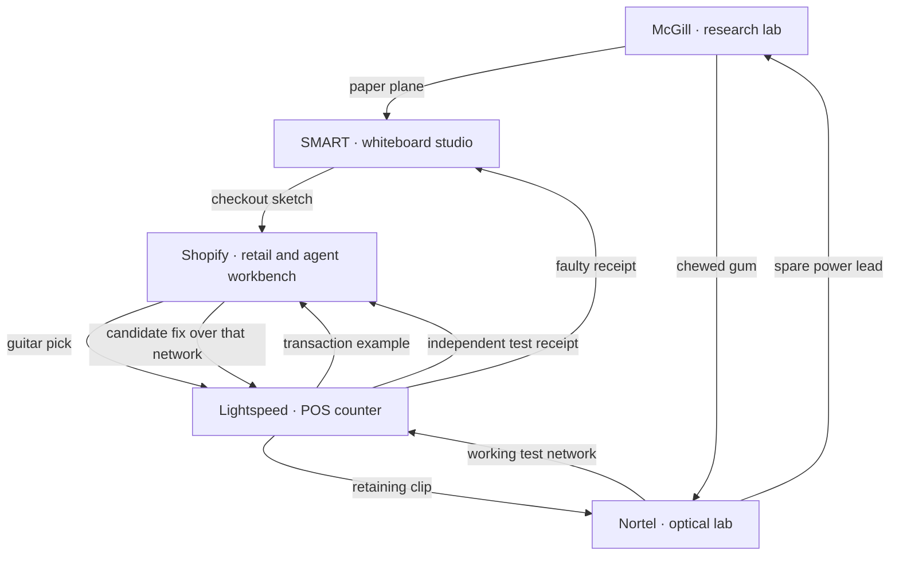
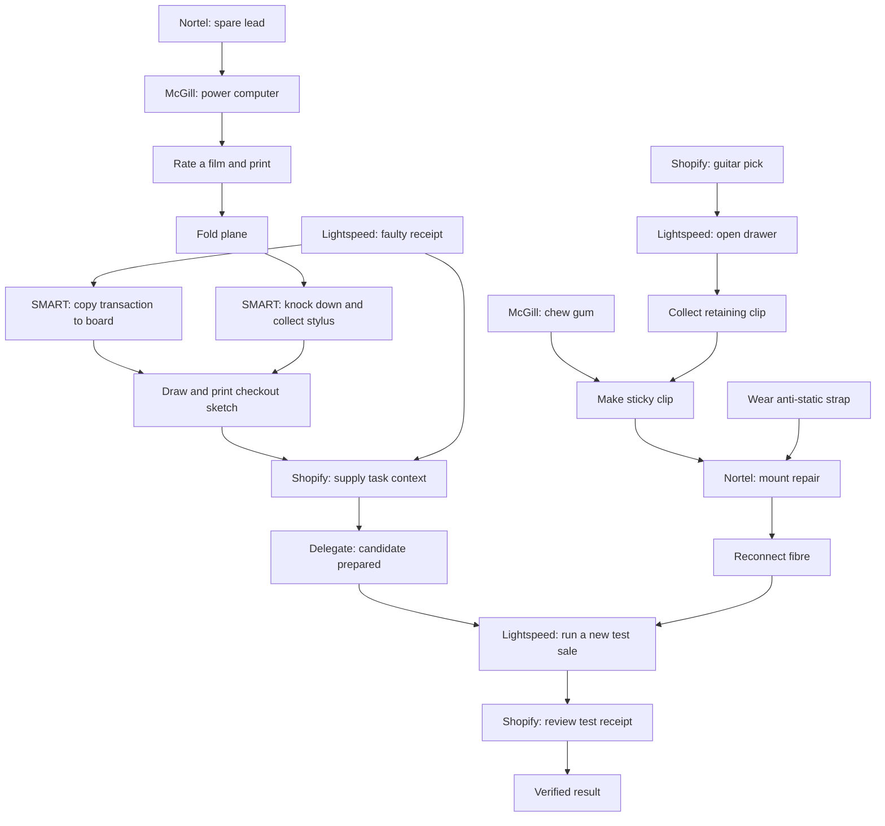

# One adventure across five rooms

Status: the shared foundation and five-room puzzle rules are implemented. The connected rules run through reducer fixtures; SMART also has a real scene adapter. The live prototype has three explorable rooms with shared inventory, one adventure save, free exits and a whole-adventure restart. Its original local puzzles are retained during the transition. This document defines the connected adventure; it is not an in-game walkthrough or a claim that the other rooms exist yet.

The five main rooms are McGill, Nortel, SMART Technologies, Lightspeed and Shopify. Their arrangement tells the career chronologically. Their puzzles cross that arrangement in both directions. Timney Lab remains an optional prologue outside the required path.

All scenes, props, transactions and incidents below are fictional framing around the owner's supplied career facts. The Shopify sequence illustrates directing and checking an agent's work; it does not describe a particular real project or employer system.

## The room map

The arrows show things that travel or become available, not a required visiting order. A room can contribute something on the first visit and become useful again much later. Shopify is explorable early: its pick helps start a problem several rooms away, while its workbench becomes the meeting point for the longer paths.

Doors return to the chapter map. Once the five rooms are implemented, all five map links are available from the outset, with no puzzle-completion locks. The existing map provides travel without adding a hallway, a new navigation panel or extra door artwork. Re-entering a room restores the character's position and that room's persistent changes. The short version remains directly accessible.

## Three overlapping threads

| Thread | Path | Payoff |
| --- | --- | --- |
| Put an idea on paper | Nortel lead → McGill computer → printed recommendation → paper plane → SMART stylus | SMART can produce a checkout sketch using the Lightspeed example. |
| Make a connection stay put | Shopify pick → Lightspeed drawer → retaining clip; McGill gum → sticky clip; Nortel strap → grounded repair | Nortel's loose fibre stays connected, bringing the shared test network online. |
| Direct, then verify | Lightspeed's faulty receipt + SMART's sketch → Shopify candidate; working Nortel link → Lightspeed test → Shopify review | The agent's proposed fix is checked against a new transaction before the adventure concludes. |

The paper and hardware threads can be advanced independently. The transaction example can be collected at any time. The agent can prepare a candidate before the network is repaired; it stays queued until the link works. Nothing requires the player to finish one room before visiting another.

## What happens in each room

### McGill

The computer has an empty power socket. A spare lead from Nortel powers it permanently. The computer opens Recommendz; rating any one of the fictional films produces a printed recommendation. There is no secret correct movie or genre combination. The paper's usefulness is physical rather than a reward for guessing the author's taste.

Use the printout in inventory to fold a paper plane. Its later target is the stylus visibly stuck on a high ledge in the SMART room. McGill also supplies a piece of gum: Use chews it, changing the inventory item into chewed gum. That belongs to the separate Nortel repair thread.

The research-paper PDF, mentoring note and optional music interaction retain their existing roles. None is a mandatory clue or a new biographical claim. The old cinema-ticket exit gate is retired when the connected adventure ships.

### Nortel

A clearly spare power lead lies on the bench; taking it does not turn off the racks. It is a computer power lead, separate from the loose optical fibre in the equipment.

The loose fibre will not stay seated because its external retaining clip is missing and the mounting point is broken. The drawer at Lightspeed supplies a suitable plastic clip. Combine it with chewed gum from McGill to make a sticky clip; the gum holds the clip's back against the broken mount, clear of the optical connector itself.

Wear the anti-static strap, install the sticky clip, then reconnect the loose fibre. This restores the shared test network. There is no port-selection puzzle or additional PDH configuration screen.

Ungrounded contact retains the existing character shock and temporary equipment trip. The self-test recovers automatically, and the console can reset it immediately. A failed attempt never consumes the clip or gum and never clears an installed repair. Grounding and assembly can happen in either order; grounding is required before touching the rack. The spare power lead, safe inspection and travel remain available during a fault.

### SMART Technologies

A Mac and SMART Notebook whiteboard have a partially sketched checkout flow. The stylus is conspicuously stranded on a high ledge. The plane from McGill knocks it onto the floor, where it can be picked up. The plane is spent in the successful throw; the stylus remains a reusable tool.

Use the faulty Lightspeed receipt on the whiteboard to copy the transaction as a reference. The receipt stays in inventory. Use the stylus on the whiteboard to finish the flow and print a checkout sketch: quantities, unit prices and the resulting total. This is a small illustrated plan, not a coding quiz or a form.

The sketch is useful at Shopify, where it gives the agent a concrete approach. The room's career anchor is Notebook for Mac and the interactive whiteboard, rather than an invented SMART retail project.

### Lightspeed

The iOS POS demo can be used immediately. It prints a faulty receipt for two coffees at $3 each, incorrectly totaling $3. The discrepancy is visible on the paper. Values and product names are illustrative transaction data.

A shallow drawer is jammed, with a visible seam around its latch. The guitar pick from Shopify releases it. Inside is a spare retaining clip from the counter's cable management. Opening the drawer leaves it open; the pick remains reusable. This feeds Nortel's repair, while the faulty receipt feeds both SMART's planning and Shopify's task brief.

After Shopify has prepared a candidate and Nortel's network works, using the POS runs a different test sale: three coffees at $3, correctly totaling $9. Its printed test receipt is tied to the candidate that was actually run. That new receipt goes back to Shopify as evidence. Printing the initial faulty receipt never counts as running the candidate.

### Shopify

A guitar pick sits beside the Birch Green Jazzmaster. It is freely available on the first visit; guitar playing and optional music never gate progress.

Give the workbench the SMART checkout sketch and the original faulty Lightspeed receipt, in either order. Using the workbench then delegates the task and produces a candidate fix. Both reference items remain available. The candidate can be prepared while the network is down; it is queued rather than discarded. A restored Nortel link makes it available to the Lightspeed test till.

The final step requires bringing back the new Lightspeed test receipt and using it at the workbench. The receipt must belong to the current candidate and the independent three-item test. Receipt inspection makes the arithmetic readable, but a hidden requirement to click Look is unnecessary. Verification comes from actually running the test and returning its result.

Completion is a quiet, inspectable success in this room: the verified receipt and the finished workbench. It does not force a credits screen, remove inventory, lock rooms or require a long reflection. The player can continue exploring. The sequence demonstrates supplying context, planning, delegation and verification without a live AI service, code-entry task or extra command vocabulary.

## Dependency diagram

This is the critical path after free collection/travel. Multiple prerequisites at a join are all required.

This yields long paths through four or five rooms and two independent branches joining at the test. No dependency loop requires an item from its own future reward. The room map contains loops because travel and revisits are allowed; the prerequisite graph has none.

## Item lifecycle

| Item | Source and transformation | Use and fate |
| --- | --- | --- |
| Power lead | Spare on Nortel bench | Installed at McGill; remains there. No later puzzle needs it. |
| Gum | McGill desk → chewed gum | Combines with the retaining clip; no unrelated action consumes it. |
| Recommendation | Printed at powered McGill computer → paper plane | Successful SMART throw spends the plane. Wrong throws retain it. Reprintable while the stylus is still needed. |
| Guitar pick | Beside Shopify guitar | Releases Lightspeed drawer; retained as a tool. |
| Retaining clip | Lightspeed drawer → sticky clip with chewed gum | Installed on Nortel's external mount; remains installed. |
| Anti-static strap | Nortel bench; can be worn directly or collected first | Retained, with worn/grounded state. Moving rooms does not unequip it. |
| Stylus | Knocked down at SMART, then collected | Draws the checkout sketch; retained as a tool. |
| Faulty receipt | Initial Lightspeed transaction | Reference at SMART and Shopify; copied, never consumed. |
| Checkout sketch | SMART Notebook, after stylus and copied example | Context at Shopify; retained and reprintable. |
| Test receipt | Lightspeed, after candidate and working network | Evidence at Shopify; retained and reprintable for that candidate. |

Inventory transformations replace their inputs atomically. Combining gum and clip works in either item-selection order. Printing keeps at most one inventory copy of each paper; recommendation and plane share one slot in that family. Scene pickups cannot regenerate after their item has changed form or been installed. Reusable tools remain available, so future optional gags can reuse them without changing the critical path.

### Recovery and order independence

- All five rooms and exits stay accessible, including during faults and after completion.
- Wrong item uses and throws give a short response and retain critical items. No discard mechanic, money, timing challenge or missable pickup is introduced.
- An ungrounded repair attempt trips the equipment without consuming its ingredients; resetting never removes earned progress.
- Plugging the fibre in before repairing the mount does not stick, and leaves it available. Mounting the clip and making the plan have no timed window.
- The receipt can be collected before the pick, lead, plane or stylus. The sketch and faulty receipt can be supplied to the agent in either order.
- Preparing the candidate before or after restoring the network has the same result. A queued candidate automatically becomes available once the link works.
- A current test receipt can be reprinted if needed. A stale or unrelated receipt cannot verify a candidate; it is retained and can be replaced by running the current test.
- There is one whole-adventure Restart. Per-room resets would strand shared items or invalidate progress elsewhere. The confirmation must describe the whole-adventure reset when this model is implemented.

## Clues, presentation and boundaries

The observable problems carry the clues: empty power socket, spare lead, high stylus, jammed drawer seam, missing retainer and readable receipt arithmetic. Looking at an object can reveal its condition. These are terse world observations, not a quest list or a narrated solution.

Retain the existing nine verbs, pictorial inventory, quiet labels, direct map/short-version navigation, approved room/character art and the restored walking jiggle. Use on inventory paper folds it; Use on gum chews it; selecting one inventory item and using it with another handles the clip recipe. Transformations and combinations must work with keyboard and touch. Do not add a crafting screen, hint button, journal, objective panel or five completion badges.

Keep the current supplied McGill year; do not invent dates for later rooms. Mentoring, art, music and an eventual Timney prologue can add optional interactions without introducing critical dependencies. A future personal anecdote can replace a fictional gag without changing the whole graph.

## From the prototype to this adventure

The existing reducer remains pure TypeScript. This design requires one adventure session with shared inventory, persistent world milestones, a position for each room and the current room. Individual rooms continue to own scenery and local interactions. Open dialogs, hover, speech, walk timers and the static fault remain transient. No general story scripting engine, backend or runtime dependency is needed.

The shared-state foundation covers the three existing rooms. The full graph and transformations run through test fixtures, and SMART has a real scene adapter; the remaining public integration is next:

1. **Implemented:** move inventory and save ownership above the mounted room session. Room switching must not reload an independent inventory or start a new adventure.
2. **Implemented:** render inventory from a shared item registry in every room. The composition registry now supplies the same item catalogue to both views.
3. **Implemented:** make item pickup/use preserve unrelated inventory. Collecting or wearing the strap now preserves every unrelated carried item.
4. **Implemented:** keep scene travel separate from completion. Existing room exits no longer require their local puzzle; future exits follow the same policy. Reserve final completion for the verified Shopify result.
5. **Rules implemented:** explicit item-on-item use, atomic recipes and source/form tracking handle folding, chewing and the sticky clip. The scene integration must translate inventory clicks, keyboard activation and touch into these actions; the live prototype still uses its current ticket/strap interactions.
6. **Implemented:** introduce one versioned whole-adventure save and one whole-adventure restart. Preserve legacy saves during migration and retain per-room coordinates.

### Save compatibility

Use a new `savagely-optimized:adventure:v1` save key with an explicit payload version. A valid new save takes precedence; only an absent new save is eligible to import the old McGill/Nortel saves. Preserve the old keys as recovery data. A deliberate Restart writes a valid fresh adventure save so it cannot re-import completed legacy chapters.

For the full-web cutover, the tested `migratePrototypeProgress` function turns a legacy McGill ticket into a powered computer and a foldable printed recommendation, with its power lead already installed. It does not require the old genre puzzle again. A restored Nortel link imports the repaired mount, connected fibre and owned/worn strap; its new clip/gum branch is already satisfied. Sources for those installed items are marked resolved so they cannot mint extra copies. Other free items remain available. Unfinished Nortel saves keep any owned strap and its worn state. The existing legacy decoders still validate old versions, flags and room coordinates before this conversion. Neither old chapter-completed flag implies that the new whole adventure is finished.

The connected puzzle slice has a v2 decoder in `src/game/story/save.ts`. It validates source/form consistency, candidate identity and receipt evidence, and rejects impossible or unsupported saves instead of removing critical items. A stale receipt can be retained and replaced by rerunning the current candidate. Positions and the last room belong to the surrounding adventure save. This decoder and migration are exercised in tests; the full story conversion remains inactive until all required scenes and views exist. The browser world payload now uses its own version 2 for the SMART addition, accepts the former two-room payload and adds a SMART spawn without changing earned progress. The connected slice version is separate from the world payload revision.

An invalid or unsupported adventure save is preserved byte-for-byte. Start a temporary in-memory visit, announce the load problem through the existing save-status area, and suppress writes over that save until the player deliberately uses Restart. Do not fall back to legacy import on every load. Denied or failed storage still permits an in-memory adventure and uses the existing save-failure announcement. The browser currently imports the existing ticket, strap, Nortel milestones and both positions; it does not activate the connected power-lead/printout/clip states yet. Import, protected recovery and whole-adventure reset have unit and browser coverage. A deliberate reset keeps the current room, resets all positions to their spawns, and clears shared progress.

### Implementation order

1. **Foundation complete:** shared state, inventory, free travel and legacy migration have been implemented and tested with the existing rooms and reducer fixtures. Keep the deployed puzzles working during the transition.
2. **Rules complete:** the dependency graph runs through the shared reducer using fixtures, including consumption, repeat actions, failed uses and candidate-bound evidence. Paper-first, hardware-first and retail-first journeys complete. A traversal of actual reducer transitions confirms every reachable milestone prefix can still finish.
3. **SMART scene implemented; next:** build Lightspeed and Shopify and connect their props to these rules. SMART is freely explorable with the owner-supplied cubicle/iMac/PC/whiteboard setting. Its required future items are seeded only by browser tests; normal play has no substitute sources. Add their inventory controls, film-rating view, persistent projections and versioned browser-save cutover. Preserve the existing visual world. Mark each public room playable only when it exists.
4. Publish the interconnected story once all its required destinations work. The existing scenes are infrastructure and the opening threads of this graph. Do not invent a temporary Nortel payoff for the plane or silently collapse the design back into paired rooms.

## Design-check model

The following table is a compact resource model for checking the proposed graph. IDs are planning names, not a runtime schema or scripting format. `i.` denotes a carried item; `f.` denotes a persistent world fact. Each row is a single successful milestone, possibly covering a few UI clicks. A pickup moves a unique scene object, so its row runs once. All rooms are available initially. The separate recovery rules above govern retries and reprinting.

| Step | Room | Requires | Consumes | Adds |
| --- | --- | --- | --- | --- |
| take-lead | nortel | — | — | i.power-lead |
| power-computer | mcgill | i.power-lead | i.power-lead | f.computerPowered |
| print-recommendation | mcgill | f.computerPowered | — | i.recommendation |
| fold-plane | mcgill | i.recommendation | i.recommendation | i.paper-plane |
| knock-stylus-down | smart | i.paper-plane | i.paper-plane | f.stylusDown |
| take-stylus | smart | f.stylusDown | — | i.stylus |
| take-pick | shopify | — | — | i.guitar-pick |
| open-drawer | lightspeed | i.guitar-pick | — | f.drawerOpen |
| take-clip | lightspeed | f.drawerOpen | — | i.retaining-clip |
| take-gum | mcgill | — | — | i.gum |
| chew-gum | inventory | i.gum | i.gum | i.chewed-gum |
| make-sticky-clip | inventory | i.chewed-gum, i.retaining-clip | i.chewed-gum, i.retaining-clip | i.sticky-clip |
| wear-strap | nortel | — | — | i.strap, f.strapWorn |
| mount-clip | nortel | i.sticky-clip, f.strapWorn | i.sticky-clip | f.clipMounted |
| connect-fibre | nortel | f.clipMounted, f.strapWorn | — | f.linkRestored |
| print-bad-receipt | lightspeed | — | — | i.faulty-receipt |
| copy-example | smart | i.faulty-receipt | — | f.exampleOnBoard |
| draw-plan | smart | i.stylus, f.exampleOnBoard | — | i.checkout-plan |
| provide-plan | shopify | i.checkout-plan | — | f.agentHasPlan |
| provide-example | shopify | i.faulty-receipt | — | f.agentHasExample |
| prepare-candidate | shopify | f.agentHasPlan, f.agentHasExample | — | f.candidatePrepared |
| test-candidate | lightspeed | f.candidatePrepared, f.linkRestored | — | i.test-receipt, f.testSalePassed |
| review-result | shopify | i.test-receipt, f.candidatePrepared, f.testSalePassed | — | f.reviewComplete |

A design check should confirm that every prerequisite has a source, no consumed item is needed later in its old form, the final result is reachable with different room priorities, and every prefix of a legal milestone order can still reach the result. This table remains a design model rather than the runtime schema. Candidate identity, repeat actions, failed repairs, migration and save validation now have implementation tests too.

Design validation: the resource model has 23 successful milestones and 1,122 reachable states. Every reachable milestone prefix can still reach the ending, and every ending depends on all five main rooms. Separately, `tests/unit/story.test.ts` explores the implemented reducer transitions with those milestones and verifies recovery from every reachable prefix. It also validates the persistent slice at every visited transition. This covers puzzle logic; it does not establish that the future scenes, controls or artwork have shipped.
